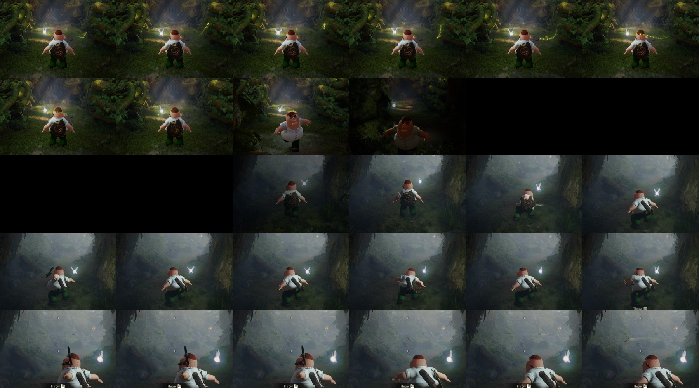

# Asset Swapper



*A third-party model (not included in this repo) replacing the child player in game.*

A desktop tool that replaces the Player and NPC models in static recompilations of *The Legend of Zelda: Ocarina of Time* (Switch 2), such as **Hookshot**, with models from other games, **as a mod**. The game's own files and executable are never modified: the tool reads your romfs and writes only a mod folder.

> This repo contains no game data and no third-party models. You need your own copy of the game, and you are responsible for the licence of any model you import.

## Features

- **Model picker** with textured thumbnails, search, filter and sort; **plain names** instead of file paths.
- **OpenGL preview** with the model's textures; **X-ray mode** to see and drag the skeleton's joints.
- **Fit to the original**: the game's own model is shown locked in place, see-through, and a gizmo moves, rotates (each axis separately) and scales yours against it.
- **Simple bone editor**: a list of body parts (head, left upper arm, ...) with what each matched; the full joint list is behind an advanced switch.

- **Import** `.glb`/`.gltf`/`.obj` directly; `.fbx`/`.dae` through Blender (set `BLENDER` to `blender.exe`).
- **Auto-retarget** a rigged model onto the game's skeleton, keeping its skin weights, so the game's animations drive it. Unrigged models get automatic weights.
- **Manual correction UI** (Tk): bone map, part-to-shape map, textures, fit and attachments, equipment.
- **Textures** are re-encoded (BC1/ASTC) in place into the game's own texture files, including every mip level.
- **Fixes for imported models**: back-face winding repair, gap-closing parts merged into the main mesh (`merge_parts`), shield/sword clipping (`flatten_back`), arm-only skeleton fitting (`fit_skeleton`), zigzag-free elbows (`arm_stiffness`), longer arms (`arm_length`), armpit relief, hidden worn equipment.
- **Backups and revert**: every build backs up the previous mod; switch mods on/off or restore from the *Backups & revert* tab.

## Quick start (Windows)

1. Download `AssetSwapper-v1.2.0-win64.zip` from [Releases](../../releases), unzip anywhere.
2. Run `Asset Swapper.exe`; point it at your game's `romfs` folder if asked (the mod is written to the `mods` folder beside it).
3. Pick the model to **Replace** (`Player_Child`, `Player_Adult`, an NPC) and **With model**, then *Load*.
4. Fix the bone map / parts / textures if needed, then **Build mod**.
5. Start the game. Prefix the mod folder with `-` to turn it off.

Full guide: [docs/asset-swap.md](docs/asset-swap.md).

## From source

```bash
pip install -r requirements.txt
python -I tools/assetswap ui
python -I tools/assetswap swap <romfs> Model/Player_Child.Player_Child.bfres.zs model.glb --mod <mods>/<name> --profile profile.json
python -I tests/test_assetswap.py
```

Other commands: `inspect`, `preview`, `preview-import`, `export-obj`, `backup`.

## Build the exe

Needs Python 3.12-3.14 with `pyinstaller numpy pillow zstandard`:

```bat
tools\assetswap\build_exe.bat path\to\python.exe
```

Output goes to `dist\Asset Swapper\`.

## Known limits

- Models bigger than the game's own need a larger resource size table: the tool writes it into the mod. Only one mod's table is used, so keep one table with all the entries.
- Replacing Navi (`Npc_Navi`) is not working yet: the mod loads but the new model is not drawn.
- Child face texture is 12x12 ASTC, so fine detail is coarse; body texture has some edge roughness.
- With straight arms the held sword floats near the hand (see `hand_follows_wrist`).
- Shapes keep the game's materials; normal/roughness/occlusion maps are neutral.
- Poses beyond walking and jumping (roll, climb, swim) are lightly tested.

See [CHANGELOG.md](CHANGELOG.md) for history.

## Licence

GPL-3.0, see [LICENSE](LICENSE).
